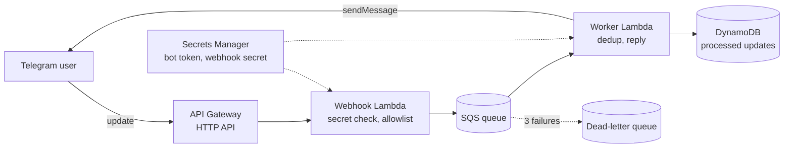

# StudyBuddy

**A multimodal AI study assistant on Telegram that answers from your own course material, by text, voice or photo, built on AWS.**

> Status: **week 1 of 6**. The serverless pipeline is live: Telegram → AWS → reply. The AI agent arrives in week 2.

## Architecture



Planned (weeks 2–6): a Strands agent on Amazon Bedrock AgentCore with tools for course retrieval
(S3 Vectors), speech (Transcribe, Polly), vision (Claude) and images (Nova Canvas), plus per-user memory.

## Features

| Feature | Status |
| --- | --- |
| Telegram webhook with secret-token verification | Done |
| Allowlist of Telegram users | Done |
| Async processing with SQS, dead-letter queue and alarm | Done |
| Idempotent processing (duplicate deliveries ignored) | Done |
| Budget alerts | Done |
| AI agent with conversation context | Week 2 |
| Voice notes and photos | Week 3 |
| Answers from course PDFs with citations, long-term memory | Week 4 |
| Quizzes, guardrails, /forget, image generation | Week 5 |
| Evaluation suite and results | Week 6 |

## Results

Measured results (accuracy, citations, latency, cost per message) will be published here in week 6.

## Quickstart

Prerequisites: an AWS account signed in with `aws login`, Python 3.12+, Node.js 20+, and a Telegram bot token from [@BotFather](https://t.me/BotFather).
Full Windows walkthrough: [docs/setup-windows.md](docs/setup-windows.md).

```powershell
py -m venv .venv; .\.venv\Scripts\Activate.ps1; pip install -r requirements-dev.txt
.\scripts\deploy.ps1 -AllowedUserIds <your Telegram user ID> -BudgetEmail <your email>
.\scripts\set-token.ps1
.\scripts\set-webhook.ps1
```

Then send a message to your bot. Remove everything with `.\scripts\destroy.ps1`.

## Development

```powershell
pytest            # unit + infrastructure tests
ruff check .      # lint
mypy              # type-check
```

## Design decisions

- [ADR-001: Telegram first, WhatsApp later](docs/adr/001-telegram-before-whatsapp.md)
- [ADR-002: Asynchronous processing with SQS](docs/adr/002-async-webhook-with-sqs.md)
- [ADR-003: S3 Vectors for retrieval](docs/adr/003-s3-vectors-for-retrieval.md)

## Cost

Everything is serverless and pay-per-use. Idle cost is about **$0.40/month** (one Secrets Manager secret);
week-1 usage stays within free allowances. Model costs start in week 2 and are tracked per message.

## Author

Ameni Ben Youssef. MIT licence.
